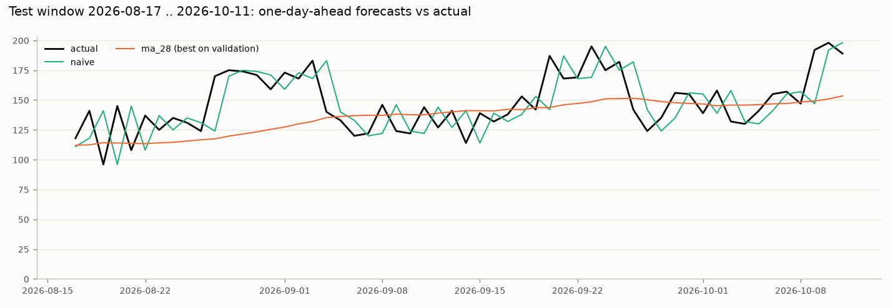
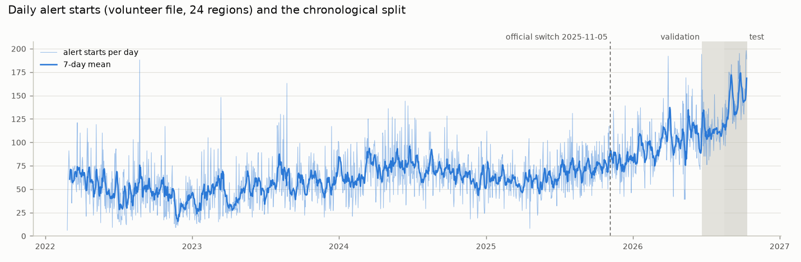

# Forecasting air-raid alerts in Ukraine, one day ahead, without leakage

KSE Agentic AI School, Stage 2. The question: how many air-raid alerts will start in Ukraine tomorrow, using only what is
known at midnight? The forecast is evaluated on the latest 8 weeks of data (2026-08-17 to 2026-10-11) and no information
from after the forecast moment is used anywhere.

**Headline result.** On the 56 validation days the models chosen there beat the naive forecast ("same as yesterday") by
34-38%. On the 56 test days none of them does: the alert level rose from 112 to 148 starts a day, and models with a long
memory run low. The result is reported as it is, without tuning on the test window (see [Results](#results)).

## What is predicted

| | |
|---|---|
| **Target** | `y[D]` = number of air-raid alerts that start anywhere in Ukraine on Kyiv calendar day `D` (24 regions, volunteer record) |
| **Forecast moment** | 00:00 Kyiv on day `D` |
| **Horizon** | one day: the whole of day `D` |
| **Allowed inputs** | alert starts from days before `D`; the weekday of `D` (a calendar fact) |
| **Not allowed** | any record at or after 00:00 of `D`; anything fitted or chosen on the test window |
| **Split** | train 2022-02-25 to 2026-06-21, validation 2026-06-22 to 2026-08-16, test 2026-08-17 to 2026-10-11 (56 days each) |
| **Models** | naive, weekly seasonal naive, 4-week seasonal mean, moving averages (3/7/14/28 days), Ridge on lags |
| **Metric** | MAE (main), RMSE, MAE as % of the mean, skill = 1 - MAE / MAE of naive, bias |

### The three ideas to defend, in plain words

**The target.** For every calendar day in Kyiv we count how many alerts started anywhere in Ukraine. An alert is counted on
the day it starts, even if it runs past midnight, so the number for a day is settled by what happens during that day, and
end times are never used. (A target based on alert-hours was considered and rejected: it needs end times, 3-10% of
volunteer end times are placeholders, and in the official file a few front-line alerts last for months.)

**Walk-forward evaluation.** We replay history one day at a time. For each test day we pretend it is 00:00 of that day,
give the model only the earlier data, write down its forecast, and then move on by one day. Every test day is forecast
once, by a model that has not seen it, and the score is the average error over the 56 days. Ridge is refitted at every
step on the data available at that moment.

**The truncation test.** Take the forecast for a day `D` from the normal pipeline. Now delete every alert that started at or
after 00:00 of `D`, rebuild the daily series from what is left, and forecast `D` again from scratch. The two numbers must be
equal; if they are not, the pipeline used information from the future. The test is also shown to be able to fail: it
catches a moving average that forgot to leave the current day out.

## Data

Dataset: [Vadimkin/ukrainian-air-raid-sirens-dataset](https://github.com/Vadimkin/ukrainian-air-raid-sirens-dataset),
pinned to commit `d10c80f` (2026-10-12 05:05 UTC) so every run sees the same input. Nothing was assumed: the first step
of the project is a data report ([reports/data_check.md](reports/data_check.md)) and the cutoff and target were decided
from it. What it showed:

- **The official file is stale and flawed.** It ends on 2026-09-07 08:28 Kyiv, 35 days before the snapshot, and has no alert
  starts for 105 hours (2026-08-29 07:55 to 2026-09-02 16:48; the next-longest silence since 2025 is 19 hours). 38% of its
  rows are exact duplicates: the history up to 2026-01-25 is in the file twice, which makes raw monthly totals fall by half
  in February 2026 for no real reason. 897 alerts last more than 24 hours, up to 604 days, mostly raion and hromada alerts
  in Donetska and Dnipropetrovska oblasts.
- **The late-2025 drop is a change in how alerts are recorded, not missing data.** In the official file, oblast-level rows go
  from 10 on 2025-11-04 to 1 on 2025-11-05 while raion-level rows jump (115, 268, 330 on consecutive days) and total rows
  rise ([figure](reports/fig_daily_counts_by_level.png)). The roll-out was staged: a few oblasts were mostly
  raion-level already in early 2025, most switched between August and November 2025. A model trained on
  `level == 'oblast'` rows after that date sees a series of about 2 rows a day (59 a day in 2024), so any score on it is
  meaningless, which is why an MAE of 1.26 measured on that period in the summer project said nothing.
- **The volunteer file is the only current source.** It runs to 2026-10-12 07:49 Kyiv, has no duplicates, no gap of 8 hours
  or more since 2025, and the same 25 region names. The target is built from it (Luhanska oblast has 3 rows, all in 2022,
  and is excluded; the partial last day 2026-10-12 is dropped). The official file is used only to date the switch and as a
  cross-check: the daily number of regions with an alert start agrees with it (correlation 0.99 in 2024, 0.94 in 2025 H1,
  0.96 in 2026-03 to 08-28).

## A measurement question that was checked before modelling

The volunteer file has 2.5 times more alert starts in September 2026 (4,449) than in an average month of H1 2025 (about
1,800), while the number of regions with an alert start per day stays between 16 and 19 until August 2026 (20-21 in
the last two months). That could mean real alerts are being split into several starts after the
switch to raion-level alerting, which would change what the series measures.
[src/check_measurement.py](src/check_measurement.py) tests it, with the rule written down before the numbers were seen:
the switch counts as a jump if starts per active region-day over the 90 days after 2025-11-05, divided by the same figure
for the 90 days before, is among the top 3 of 29 such ratios (the switch and 28 placebo dates).
Full table and figure: [reports/volunteer_measurement_check.md](reports/volunteer_measurement_check.md),
[reports/fig_volunteer_measurement.png](reports/fig_volunteer_measurement.png).

- **No jump at the switch.** Ratio 1.126, rank 8 of 29. The largest monthly changes are in March 2026 (+24%), March 2024
  (+18%) and August 2026 (+16%), none of them at the switch.
- **But a steady drift.** Starts per active region-day: 3.2-4.3 in 2024, 3.3-3.7 in H1 2025, 4.1-4.4 in Aug-Nov 2025,
  4.8-4.9 in Dec 2025-Feb 2026, 5.8-6.2 in Mar-Jul 2026, 7.2 in Aug-Sep 2026. Over the same period the monthly sum of
  alert durations is flat (about 1,400-2,100 hours), the median duration of an alert falls from 30-40 to 17 minutes, and
  the share of starts that follow another alert of the same region within 15 minutes rises from 4-6% to 11%. That is the
  pattern of more and shorter alerts covering the same time: either real tactics or a change in how alerts are cut up,
  and the next subsection looks at the second possibility.
- **What follows.** The level of the target drifts upward, so models are compared on validation and then checked on test
  rather than assumed to carry over. Baselines look back at most 28 days and have no training window; for Ridge the
  training window (all history vs after the switch) is a setting chosen on validation.

### Why the drift happens: how the volunteer rows are made

The dataset's own code ([processors/volunteer_etryvoga_processor.py](https://github.com/Vadimkin/ukrainian-air-raid-sirens-dataset/blob/main/processors/volunteer_etryvoga_processor.py),
lines 230-258 and 294-324) shows where an "alert start" comes from. It reads the messages of a public Telegram channel.
For each message it finds the oblast whose name or town aliases occur in the text (the first match wins) and decides
whether the message announces or ends an alert. It keeps at most one open alert per oblast: a start message opens it (or
replaces it), and any end message that names the oblast closes it and writes a row. The code has no idea of raions. When
alerts are reported per raion, an all-clear for one raion therefore closes the whole oblast's row even if other raions
are still under alert, and the next raion alert opens a new row. That can cut one long oblast-wide alert into several
shorter rows, which is the pattern seen in the data. The last change to this code is from 2024-06-01 (checked in the
repository history), so the parser did not change at the switch; what changed is what it is fed, because alerts are now
issued per raion.

How much of the rise sits in rows that follow the previous alert of the same region closely? If a start within G minutes
of the end of the region's previous alert is counted as part of that alert, starts per active region-day become
(from [reports/volunteer_measurement_check.md](reports/volunteer_measurement_check.md)):

| | 2025 H1 | 2025 Q4 | Aug-Sep 2026 | Aug-Sep 2026 / 2025 H1 |
|---|---|---|---|---|
| rows as published | 3.50 | 4.42 | 7.21 | 2.06 |
| merged if gap <= 10 min | 3.39 | 4.22 | 6.66 | 1.96 |
| merged if gap <= 30 min | 3.18 | 3.84 | 5.70 | 1.79 |
| merged if gap <= 60 min | 2.85 | 3.31 | 4.42 | 1.55 |
| merged if gap <= 120 min | 2.35 | 2.54 | 2.93 | 1.25 |

The rise from H1 2025 to Aug-Sep 2026 shrinks from about 2.1 times to 1.25 times when alerts within two hours of each
other are merged. That is what splitting would produce. It is also what a real increase in the number of separate waves
would produce, and the data cannot tell the two apart (the repository has no archive of the raw messages to replay). The
reading of the code is certain; that it explains the drift is an inference. The target was **not** changed in response:
it stays the number of alert starts as published, the drift is documented, and the models are judged on the latest
window as it is.

## Leakage controls

| Where | Risk | Control |
|---|---|---|
| Data and cleaning | choosing the cutoff or cleaning rules after seeing scores | rules fixed from the data report before any model existed: exclude Luhanska, drop the partial last day, no interpolation |
| Target | an alert that runs past midnight bringing end-time information into the previous day | only start times are used; an alert belongs to the Kyiv day it starts (tested, including the summer/winter time change) |
| Target | the snapshot contains the first hours of 2026-10-12 | the last complete day is 2026-10-11; the forecast for 2026-10-12 uses data up to 2026-10-11 only |
| Target | filling or smoothing gaps | nothing is filled; days with zero starts nationwide would be listed in `reports/target_check.md` (none) |
| Split | random or overlapping windows | chronological train < validation < test, checked in code (`src/split.py`) |
| Baselines | a moving average that includes the current day | every input is shifted before use; the truncation test compares the fast code with a from-scratch version on data cut at 00:00 of the forecast day |
| Ridge | features or scaler using the future | features come from earlier days plus the weekday; the scaler lives inside the pipeline and is fitted on training rows only; Ridge is refitted at every origin on rows strictly before it; covered by the truncation test |
| Choices | tuning on test | moving-average window, Ridge alpha and training window are chosen on validation only; the test window is scored, never used to choose; all models are reported, not only the best |
| Diagnostics | the measurement check looks at the whole series | it only describes drift; no model choice depends on it |
| Availability | the dataset is published with a lag (a commit about 05:00 UTC the next day) | assumed, and stated here: the alert start times of day `D-1` are known at 00:00 of `D` from the live channel the volunteers read |
| Order of work | the test numbers of the baselines were seen before Ridge was added | the Ridge grid (alpha 0.1/1/10/100; training window all history or after the switch) was written in the plan before any result existed; it was not changed afterwards |

## Results

Chosen on validation only: moving-average window 28; Ridge alpha 0.1 with all history (validation MAE 13.23 vs 13.73 for
training only after the switch). Mean starts per day: validation 111.6, test 148.1.

| model | validation MAE | test MAE | test MAE % of mean | test skill vs naive | test bias |
|---|---|---|---|---|---|
| naive (yesterday) | 20.1 | 17.0 | 11.5% | 0 | -1.4 |
| seasonal naive (same weekday last week) | 21.7 | 27.7 | 18.7% | -0.63 | -6.5 |
| seasonal mean (same weekday, 4 weeks) | 15.6 | 21.9 | 14.8% | -0.29 | -14.2 |
| moving average, 3 days | 15.2 | 16.3 | 11.0% | +0.04 | -3.1 |
| moving average, 7 days | 14.9 | 18.7 | 12.6% | -0.10 | -4.7 |
| moving average, 14 days | 13.6 | 21.9 | 14.7% | -0.29 | -6.7 |
| **moving average, 28 days (best on validation)** | **12.4** | 20.5 | 13.9% | -0.21 | -12.0 |
| Ridge (alpha 0.1, all history) | 13.2 | 18.6 | 12.6% | -0.10 | -9.3 |

Bias is the mean of forecast minus actual. Details: [reports/results.md](reports/results.md),
[reports/results.csv](reports/results.csv), [reports/forecasts.csv](reports/forecasts.csv).



How to read it:

- On validation the longer the memory, the better (MAE 20.1 for naive down to 12.4 for 28 days), and Ridge lands second.
- On test the order reverses. The level rose from 112 to 148 starts a day (monthly means 126 in August, 148 in September,
  158 in the first 11 days of October), and a 28-day average lags a rising series: its bias is -12 starts a day, Ridge's
  -9, naive's -1.4. The 56-day validation window was flat and could not show this. Part of the rise is probably an artifact of how the
  volunteer rows are cut up (see [Why the drift happens](#why-the-drift-happens-how-the-volunteer-rows-are-made)).
- The best model on test, the 3-day average (16.3 vs 17.0 for naive), was fifth on validation. No significance test was
  run; with 56 days that difference should not be read as a ranking.
- The weekly pattern is weak (mean starts by weekday: Sunday 63, Thursday 71), which is why the weekly baselines lose.
- Forecast for the day after the data ends, 2026-10-12, made with data through 2026-10-11:
  [reports/next_day_forecast_2026-10-12.csv](reports/next_day_forecast_2026-10-12.csv) (naive 189, 28-day average 155,
  Ridge 166). It can be scored once the dataset snapshot of 2026-10-13 is out.



## How the results were checked

Beyond the two unit tests, four checks were run on the committed code; the first two are scripts in `checks/`.

- **The tests catch leakage** (`python checks/mutation_check.py`). Ten deliberately wrong versions of the code are injected
  one at a time into a copy: a moving average without the one-day shift, naive using today, a weekly lag off by one day, a
  Ridge trained on rows that include the forecast day, a scaler fitted on all rows including the future, a feature taken
  from tomorrow, alerts assigned to the UTC date instead of the Kyiv date, and the partial last day kept. The two tests
  fail (or raise an error) for all ten.
- **Nothing chosen on validation depends on the test window** (`python checks/isolation_check.py`). With the test window
  overwritten (three times its values plus noise), the validation scores, the Ridge grid, the chosen moving-average window
  and the chosen Ridge settings are unchanged. Adding 1000 to day D and to every later day changes no forecast for D, for
  the baselines and for Ridge, at five origins spread over validation and test.
- **A clean copy reproduces the results.** The committed files were copied to an empty folder, the pinned data was
  downloaded again and the pipeline was run: every file in `reports/` is identical byte for byte, except the download
  times in `data_snapshot.json`; the sha256 of both input files is the same.
- **A second implementation agrees.** The monthly table of the measurement check was recomputed independently with the
  standard library only (no pandas): every value and the switch test (ratio 1.126161, 7 of 28 placebo ratios at or above
  it) are the same.

## Limitations

- One 56-day test window, during which the level was rising; the conclusions about model ranking are for that window.
- The volunteer record is unofficial, and what an "alert start" counts has drifted over time (see above): the target mixes
  real alert activity with the way the channel's messages are cut into alerts, and these data cannot separate the two.
- The official file ends on 2026-09-07, so the latest period exists only in the volunteer file. The two sources agree on
  how many regions have an alert each day, not on the number of alerts.
- Zakarpatska oblast has no alert start after 2026-07-30 while the other 23 regions stay active. A lull and a gap in the
  volunteer record cannot be told apart in the file; either way the effect on the daily total is at most about 0.5 starts.
- Forecasts are point forecasts for the whole country; no intervals, no per-region models, no text or media data.
- Small grids by design (4 moving-average windows, 8 Ridge settings).
- The availability assumption above.

## How to run

```powershell
python -m venv .venv
.venv\Scripts\Activate.ps1
pip install -r requirements.txt        # Python 3.12, pandas 3.0.6
python -m src.pipeline                 # downloads the pinned data (about 40 MB), writes data/ and reports/
python -m unittest discover -s tests   # two tests, no download
python -m src.pipeline --latest        # the newest dataset commit instead of the pinned one (numbers will differ)
```

`data/` is not tracked. The run order is: download, data report, target, measurement check, split, baselines and Ridge,
evaluation, next-day forecast. Downloads use the standard library with certificate checks on (`requests` failed against
its own certificate list on the development machine).

```
src/config.py             pinned dataset commit, paths, split sizes, excluded regions
src/data.py               download and snapshot (sha256 of the inputs in reports/data_snapshot.json)
src/inspect_data.py       step 1: the data report
src/target.py             step 2: daily alert starts per Kyiv day
src/check_measurement.py  does the volunteer series change meaning at the switch?
src/split.py              step 3: chronological split
src/models.py             step 4: baselines and Ridge, fast and from-scratch versions
src/evaluate.py           step 5: walk-forward evaluation, choices on validation, next-day forecast
src/pipeline.py           runs everything
tests/test_pipeline.py    alert crossing midnight; truncation test
checks/mutation_check.py  wrong or leaky versions of the code must make the tests fail
checks/isolation_check.py nothing chosen on validation depends on the test window
reports/                  committed outputs
```

## What went wrong and how it was corrected

The work was done with an AI assistant, and the full conversation is part of the submission. The corrections that mattered:

1. **A plan assumption was wrong.** The plan took 2026-10-11 as the last complete day. The data report showed the official
   file ends on 2026-09-07 with a 105-hour hole, so the latest period exists only in the volunteer file. The target was
   changed from official union-of-alerts hours to volunteer alert starts.
2. **Another was wrong in both directions.** The plan doubted that the official file has a `source` column (it does) and
   used a news date, 15 December 2025, for the switch (the data say 5 November 2025).
3. **The first version of the data report counted duplicates.** 38% of the official rows are exact copies; the report was
   rewritten to show counts with them removed.
4. **The download failed** with a certificate error from `requests`; the fix was to use the standard library with checks
   still on, not to switch checks off.
5. **A doubt about the volunteer counts led to a new check.** Rising counts might mean alerts split into more starts, the
   same trap as in the summer project. The check was written with its decision rule first. It found no jump at the switch
   and a steady drift, which is documented above instead of being waved away.
6. **The cause of the drift was looked up, not guessed.** An independent agent read the dataset's processing code and the
   key lines were read again directly: the volunteer parser keeps one open alert per oblast and cannot see raions, so it
   can cut one oblast-wide alert into several rows. This supports the doubt without proving it, and the target was left
   as chosen.
7. **The first honest evaluation was disappointing** (validation winners lose to naive on test). It is reported and
   explained, not tuned away.
